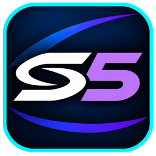

<p align="center"></p>

<p align="center">
  <a href="https://github.com/mortaljinx/Seedee5/releases/latest"></a>
  <a href="https://github.com/mortaljinx/Seedee5/releases"></a>
  <a href="https://homebrew.page/app/PPSA99142/"></a>
  <a href="LICENSE"></a>
  <br>
  
  
  
  
  
</p>

# Seedee5

**A Philips CD-i emulator for the PS5.** Seedee5 runs the SAME_CDI core (MAME's CD-i emulation) as a native PS5
homebrew title, with a cover-wheel game library, a settings screen you use from the sofa, NAS support and
picture filters for the CD-i's full-motion-video games.

No games, BIOS or keys are included. You need your own.

## Features

- **Cover wheel library.** Spin through your games with their box art, sorted A–Z. L1/R1 jump a letter.
  Lists for Favourites, Recently played, On this console and On the NAS.
- **Game cards.** Open a game and its card tells you what it is (a few lines from its Wikipedia article), its
  review scores where the article has them, the year, developer, publisher and your time played, with the game's
  own logo as its title over a dimmed in-game screenshot.
- **Games from anywhere.** The console's own storage, a USB drive, or a NAS over NFS (v3 or v4; found
  automatically on your network). Games on a NAS are copied to the console when you start them.
  Formats: `.chd`, `.cue`/`.bin`, `.iso`, and `.7z` archives of those. Multi-disc games can switch discs.
- **Straight into the game.** The CD-i player's start-up is skipped. Once you've clicked *Play CD-i* the first
  time, games start by themselves. **Continue** picks up where you left off.
- **Picture, drawn at 4K.** Default, Sharp, Smooth, Enhanced, FSR, Pixel art, Scanlines, a full CRT (phosphor
  mask, glow, curved screen) and **FMV clean-up** (light, medium, strong), which removes the MPEG blocks from the
  Digital Video games. 4:3 or 16:9, crop, and frame blending for even motion.
- **Save states, rewind** (hold L2, turned on in the game menu), and saves backed up to your NAS if you want.
- **Covers, logos and screenshots downloaded automatically** from the libretro thumbnails collection, and checked
  against the collection's own file list before they are used. Settings can turn all downloads off.
- **Controls.** The CD-i's two buttons on the face buttons (remappable), the pointer on the sticks and D-pad, with
  speed and relative/absolute aiming per game. A second controller can move the pointer too.
- **FMV games.** Mad Dog McCree, Burn:Cycle and the other Digital Video games work with the DVC ROM.

## Requirements

- A PS5 that runs homebrew titles from `/data/homebrew` (a firmware and loader that support them). Developed and
  tested on firmware 4.03.
- An FTP server on the console, to copy the app and your files over.
- The CD-i BIOS from your own player: `cdimono1.zip` (the set MAME and RetroArch's SAME_CDI use).
  `vmpega.rom` inside it (the Digital Video cartridge) is needed for the FMV games.
- Your CD-i games, as files.

## Install

1. Download `Seedee5-1.21.zip` from the Releases page and unzip it. It holds one folder, `PPSA99142`.
2. Copy that folder over FTP to `/data/homebrew/` on the console.
3. Start **Seedee5** from the home screen. On its first start it makes its folders and opens Settings.
4. Put `cdimono1.zip` in `data/system/same_cdi/bios/`, or let *Settings → CD-i BIOS* find it on your NAS.
5. Put games in `data/roms/`, or set up *Settings → NAS → Find NAS on my network*.

Everything Seedee5 keeps is in `/data/homebrew/PPSA99142/data/` (over FTP). To update, copy the new
`PPSA99142` folder over the old one; your games, saves and settings in `data/` stay. The full guide, with the
controls, is in [INSTALL.txt](title/INSTALL.txt), which also comes in the release zip.

## Controls

| Where | What |
|---|---|
| Game wheel | Left stick / D-pad spin · L1/R1 next letter · L2/R2 ten games · Cross open · Triangle favourite · Square look for games · Touch pad next list · OPTIONS settings · hold OPTIONS close |
| In a game | Sticks / D-pad move the pointer · Cross/Square button 1 · Circle/Triangle button 2 · hold L2 rewind (when Rewind is on) · touch pad menu |
| Game menu | Save/load state · discs · screen · crop · picture · rewind · reset · back to the game list |

## Building from source

Seedee5 is built on the PS5 Vulkan Template and its PS5 SDK, on Linux:

```sh
# the title is made beside the template: ~/ps5/PS5_VulkanTemplate and ~/ps5/Seedee5 (any folder works)
python3 title/make_cdi_title.py ~/ps5/Seedee5            # first time
python3 title/make_cdi_title.py ~/ps5/Seedee5 --update   # after pulling changes
# the CD-i core, libnfs, BearSSL and the 7z reader, built with the title's SDK
scripts/build_title_libs.sh ~/ps5/Seedee5
cd ~/ps5/Seedee5 && ps5/tools/build.sh
# the release zip, source archives, notices and checksums
python3 scripts/make_release.py ~/ps5/Seedee5 1.21 --with-core-source
```

`make` in this folder builds the desktop versions (`cdihost`, and `cdie_sdl`, the same engine with SDL) for testing
on a PC. How it all works, and why, is in [docs/DEVELOPMENT.md](docs/DEVELOPMENT.md).

## Credits

Seedee5 stands on other people's work:

- **CD-i emulation:** [SAME_CDI](https://github.com/libretro/same_cdi), the libretro core that builds only
  MAME's Philips CD-i driver, by Zach Morris and the libretro team. The CD-i driver itself (the CDIC, MCD212 and
  the rest of the machine) is by Ryan Holtz and the [MAME](https://www.mamedev.org/) team. Seedee5 runs this
  core with a few small patches of its own (in [`patches/`](patches)).
- **On the PS5:** mihawk-99's [PS5 Vulkan Template](https://github.com/mihawk-99/PS5_VulkanTemplate), with
  its [PS5_Mesa](https://github.com/mihawk-99/PS5_Mesa) (RADV, Mesa's Vulkan driver),
  [PS5_Vulkan](https://github.com/mihawk-99/PS5_Vulkan) and
  [PS5_PayloadSDK](https://github.com/mihawk-99/PS5_PayloadSDK), and the projects they build on; Sascha
  Willems' Vulkan example framework; and BlackBearReloaded's UI kit, from which the cover wheel's design comes.
- **Libraries:** [libnfs](https://github.com/sahlberg/libnfs) (Ronnie Sahlberg) for the NAS,
  [BearSSL](https://bearssl.org/) (Thomas Pornin) for downloads, the [LZMA SDK](https://www.7-zip.org/sdk.html)
  (Igor Pavlov) for .7z games, and [stb_image](https://github.com/nothings/stb) (Sean Barrett) for pictures.
- **Pictures:** box art, logos and screenshots from
  [libretro-thumbnails](https://github.com/libretro-thumbnails/Philips_-_CD-i) and its contributors.
- **Words:** game facts from Wikipedia's [List of CD-i games](https://en.wikipedia.org/wiki/List_of_CD-i_games),
  and each game card's text from that game's Wikipedia article, by Wikipedia's contributors (CC BY-SA 4.0).
- **Reference:** the [CDi_MiSTer](https://github.com/MiSTer-devel/CDi_MiSTer) FPGA core's CD-i hardware notes
  helped track down sound behaviour.

## Licence

Seedee5 is free software under the [GNU General Public License v3.0 or later](LICENSE). It contains the SAME_CDI
core (MAME; GPL-2.0-or-later and BSD-3-Clause), libnfs (LGPL-2.1-or-later), BearSSL (MIT), the LZMA SDK (public
domain), stb_image (public domain / MIT) and the PS5 Vulkan Template, its UI kit and runtime (MIT). Game facts are
from Wikipedia's list of CD-i games; covers, logos and screenshots from libretro-thumbnails. The text on a game's
card is fetched from Wikipedia when you open it, is © Wikipedia's contributors under
[CC BY-SA 4.0](https://creativecommons.org/licenses/by-sa/4.0/), and the card names the article it came from.

Philips and CD-i are trademarks of their owners. This project is not affiliated with them.
